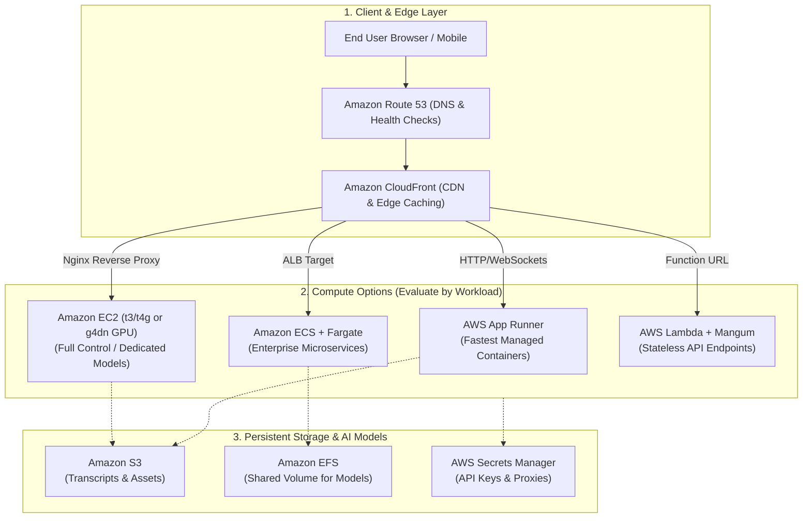
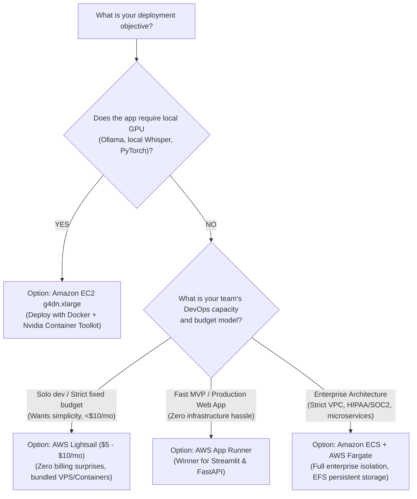

# ☁️ AWS Cloud Deployment: Deep Analysis, Architecture & Decision Guide

This document provides a deep technical analysis of deployment strategies on **Amazon Web Services (AWS)** for Python, Streamlit, FastAPI, and AI applications (such as *YouTranscribe*, *JARVIS*, *Ollama*, and *Reader*). It evaluates architectural patterns, operational complexity, WebSocket handling, cost structures, and provides prescriptive recommendations based on specific operating conditions.

---

## 📑 Table of Contents
1. [Architectural Overview](#1-architectural-overview)
2. [Deep Dive: The 6 AWS Deployment Pathways](#2-deep-dive-the-6-aws-deployment-pathways)
   - [Pathway A: AWS App Runner (Managed Containers)](#pathway-a-aws-app-runner-fully-managed-containers)
   - [Pathway B: Amazon ECS with AWS Fargate (Serverless Orchestration)](#pathway-b-amazon-ecs-on-aws-fargate)
   - [Pathway C: Amazon EC2 (Self-Managed Virtual Machines - CPU & GPU)](#pathway-c-amazon-ec2-self-managed-iaas)
   - [Pathway D: AWS Lightsail (Predictable Budget PaaS/VPS)](#pathway-d-aws-lightsail-bundled-vps--containers)
   - [Pathway E: AWS Elastic Beanstalk (Traditional PaaS)](#pathway-e-aws-elastic-beanstalk)
   - [Pathway F: AWS Lambda + API Gateway / Function URLs (Serverless Compute)](#pathway-f-aws-lambda--function-urls)
3. [Deep Comparison Matrix](#3-deep-comparison-matrix)
4. [Conditional Recommendation Engine: What to Choose When](#4-conditional-recommendation-engine-which-option-to-choose-under-what-conditions)
5. [Special Technical Considerations for AI & Streamlit](#5-special-technical-considerations-for-ai--streamlit-workloads)
6. [Step-by-Step Production Implementation Guides](#6-step-by-step-production-implementation-guides)
7. [FinOps & Cost Optimization Guide](#7-finops--cost-optimization-guide)

---

## 1. Architectural Overview



---

## 2. Deep Dive: The 6 AWS Deployment Pathways

### Pathway A: AWS App Runner (Fully Managed Containers)
AWS App Runner is a fully managed Container-as-a-Service (CaaS). It automatically provisions the underlying infrastructure, handles TLS certificate renewal, load balancing, health monitoring, and horizontal autoscaling based on incoming concurrency.

* **How It Works**: You push a Docker container to Amazon ECR. App Runner provisions instances and mounts a managed Application Load Balancer in front.
* **WebSocket Support**: ✅ **Supported natively**. Streamlit sessions remain stable because App Runner maintains connection affinity per container instance.
* **Autoscaling Behavior**: Scales based on concurrent requests (1 to 200 concurrent requests per container). When traffic drops to zero, it reduces active compute (pausing vCPU while keeping memory provisioned for rapid warm-up).
* **Pros**:
  * Zero infrastructure management (no VPCs, subnets, ALBs, or security groups required).
  * Automatic HTTPS endpoint out of the box with custom domain mapping.
  * Direct continuous deployment from GitHub or Amazon ECR.
* **Cons**:
  * No GPU instances available (cannot run local LLMs or heavy Whisper inference).
  * Storage is ephemeral (files written locally to disk disappear when containers recycle; requires Amazon S3 or DynamoDB for persistence).
  * Base cost includes provisioned memory even when idle (~$0.007/GB-hour).

---

### Pathway B: Amazon ECS on AWS Fargate (Serverless Container Orchestration)
Amazon Elastic Container Service (ECS) paired with AWS Fargate is the gold standard for enterprise-grade containerized workloads. It removes the need to patch or manage EC2 instances while providing full AWS VPC integration.

* **How It Works**: You define task definitions (CPU, RAM, container image, environment variables) and ECS services manage replica tasks behind an Application Load Balancer (ALB).
* **WebSocket Support**: ✅ **Fully supported** via ALB Target Groups. Must configure sticky sessions and set the deregistration/idle timeout to $\ge 300\text{ seconds}$ to prevent Streamlit WebSocket disconnections.
* **Storage Persistence**: Supports mounting **Amazon EFS** (Elastic File System) directly inside the container, allowing persistent transcript logging or local file databases across task restarts.
* **Pros**:
  * Complete networking isolation within custom private subnets, NAT Gateways, and Security Groups.
  * Integration with AWS Service Connect / Cloud Map for multi-service microservice architectures.
  * Granular autoscaling metrics (target tracking on CPU, RAM, or ALB request count).
* **Cons**:
  * High initial configuration overhead (requires VPC, subnets, route tables, IAM execution roles, task roles, ALB, Target Groups, and CloudWatch log groups).
  * Minimum cost is higher due to ALB base pricing (~$16–$22/month fixed for the load balancer alone).

---

### Pathway C: Amazon EC2 (Self-Managed IaaS - CPU & GPU)
Direct compute instances (Elastic Compute Cloud) running Ubuntu Linux with Nginx reverse proxy and Systemd service management.

* **How It Works**: You provision a virtual machine instance, install dependencies, clone the repository, run the application as a background service, and route traffic through Nginx with Let's Encrypt SSL.
* **GPU Availability**: ✅ **Yes**. Access to Nvidia T4 (`g4dn.xlarge`), A10G (`g5.xlarge`), or AWS Inferentia instances for running offline AI models (**Ollama, local Whisper, LLaMA 3, Stable Diffusion**).
* **WebSocket Support**: ✅ **Full control**. Nginx explicitly configured with `Upgrade` and `Connection "upgrade"` headers with custom timeouts.
* **Pros**:
  * **Cheapest continuous operation**: A `t4g.small` (ARM Graviton2, 2 vCPU, 2GB RAM) costs only **~$12/month**, or down to **~$4/month** on a 3-year Savings Plan.
  * **Persistent local disk**: File logging directly to the NVMe/EBS disk without needing S3 buckets.
  * **Static Residential/Elastic IP**: Easier to route outgoing requests or avoid shared cloud IP blacklisting.
* **Cons**:
  * **Manual maintenance**: OS security patching, certbot SSL renewal, process restarts, and disk management are completely on you.
  * No automated horizontal scaling unless paired with an Auto Scaling Group (ASG) and Load Balancer.

---

### Pathway D: AWS Lightsail (Bundled VPS & Containers)
AWS Lightsail is Amazon's simplified hosting platform with predictable, flat-rate monthly pricing designed to compete with DigitalOcean, Linode, and Render.

* **How It Works**: Offers two modes:
  1. **Lightsail Virtual Private Server (VPS)**: Flat-fee Linux instances with bundled SSD storage, static IP, and generous data transfer allowances.
  2. **Lightsail Container Services**: Simplified managed container deployment with fixed-tier pricing.
* **Pros**:
  * **No billing surprises**: Includes bandwidth transfer (e.g., $5/month includes 1 vCPU, 1GB RAM, 40GB SSD, and 1TB outbound transfer).
  * 1-click firewall, automated snapshots, and simple domain management.
* **Cons**:
  * Limited integration with broader AWS ecosystem (IAM, KMS, CloudWatch).
  * Cannot auto-scale dynamically like App Runner or ECS.

---

### Pathway E: AWS Elastic Beanstalk
AWS's original Platform-as-a-Service (PaaS) that orchestrates EC2, ALBs, and autoscaling groups using pre-configured application templates.

* **Evaluation**: While Elastic Beanstalk supports Docker and Python, it has largely been superseded by **AWS App Runner** for standalone container apps and **ECS Fargate** for multi-container apps.
* **Drawbacks for Streamlit**: Beanstalk deployment scripts (`.ebextensions`) are fragile, updates can take 5–10 minutes per deployment, and load balancer WebSocket configuration requires manual Nginx overrides.

---

### Pathway F: AWS Lambda + Function URLs (Serverless Micro-Compute)
Serverless event-driven execution charged strictly per 1ms of execution time.

* **Evaluation for Streamlit**: ❌ **Not Recommended for Streamlit**. Streamlit relies on continuous WebSocket connections and persistent in-memory session states. While adapters like `mangum` can wrap WSGI/ASGI apps for Lambda, Streamlit's WebSocket heartbeats cause Lambda to remain continuously active (eliminating cost savings) and frequently drop connection state.
* **Evaluation for FastAPI / REST APIs**: ✅ **Excellent for pure REST APIs** (e.g. `POST /api/transcribe` without UI). Can process requests in bursts with zero idle cost.

---

## 3. Deep Comparison Matrix

| Evaluation Dimension | 🚀 AWS App Runner | 🏢 Amazon ECS Fargate | 💻 Amazon EC2 (t4g/t3) | 🎮 Amazon EC2 GPU (g4dn) | ⛵ AWS Lightsail |
| :--- | :--- | :--- | :--- | :--- | :--- |
| **Ease of Deployment** | 9 / 10 | 4 / 10 | 6 / 10 | 5 / 10 | **9.5 / 10** |
| **DevOps Maintenance** | **None (Zero Ops)** | Low (Managed tasks) | High (Manual OS updates) | High (CUDA/Drivers) | Low (Simple VPS) |
| **WebSocket Compatibility** | Native & Stable | Native (Requires ALB config) | Full Control (Nginx) | Full Control (Nginx) | Native / Nginx |
| **Scale-to-Zero** | Partial (vCPU pauses) | Yes (via CloudWatch rules) | No (Always on) | No (Always on) | No (Always on) |
| **Max Execution Duration** | Unlimited (Streaming) | Unlimited (Streaming) | Unlimited | Unlimited | Unlimited |
| **GPU Acceleration** | ❌ No | ❌ No (CPU only) | ❌ No (CPU only) | ✅ **Yes (Nvidia T4)** | ❌ No |
| **Persistent Local Disk** | ❌ Ephemeral only | ✅ Via Amazon EFS | ✅ Dedicated EBS/NVMe | ✅ Dedicated EBS/NVMe | ✅ Bundled SSD |
| **VPC / Private Subnets** | Optional VPC connector | Native VPC integration | Native VPC | Native VPC | Simplified VPC |
| **Base Monthly Cost (Idle)** | ~\$5 – \$8/mo | ~\$18 – \$25/mo (ALB) | ~\$10 – \$15/mo | ~\$380/mo (On-Demand) | **\$3.50 – \$5.00/mo** |
| **Peak Concurrency Scale** | Automatic (seconds) | Automatic (1-2 minutes) | Manual / ASG | Manual / ASG | Static tier resize |

---

## 4. Conditional Recommendation Engine: Which Option to Choose Under What Conditions?



---

### Condition 1: Fast MVP, Prototype, or Solo SaaS Product
* **Recommended Service**: **AWS App Runner**
* **Why**:
  1. Streamlit web applications require minimal setup: push your Dockerfile to Amazon ECR, and App Runner manages the rest.
  2. Native WebSocket support prevents session drops.
  3. No load balancer provisioning or certificate management needed.
  4. Automatically scales down when no one is using the application, minimizing personal or startup burn rate.

---

### Condition 2: Predictable, Low-Budget Fixed Hosting ($3.50 – $10/month)
* **Recommended Service**: **AWS Lightsail** (or an EC2 `t4g.small` Reserved Instance)
* **Why**:
  1. Standard AWS services (ALBs, NAT Gateways, Data Transfer Out) can incur unexpected variable costs.
  2. Lightsail includes generous outbound data transfer (1TB–3TB) and fixed pricing.
  3. Perfect if you have steady, predictable traffic and want to eliminate billing surprises.

---

### Condition 3: Local Offline AI Models, GPU Inference & Ollama
* **Recommended Service**: **Amazon EC2 `g4dn.xlarge`** (or Spot Instance)
* **Why**:
  1. Managed serverless services (App Runner, Cloud Run, Fargate) either do not support GPUs or are cost-prohibitive for continuous memory-hungry models.
  2. A `g4dn.xlarge` gives you **16GB GPU VRAM (Nvidia T4)**, 4 vCPUs, and 16GB RAM—ideal for running **Ollama (Llama 3, Mistral)** and **faster-whisper** locally.
  3. **Cost Optimization**: Using an **EC2 Spot Instance** reduces cost by **60% to 70%** (bringing a GPU server down from ~$380/mo to ~$115/mo).

---

### Condition 4: Enterprise Multi-Tier Platform with Strict Security & VPC
* **Recommended Service**: **Amazon ECS on AWS Fargate**
* **Why**:
  1. Complete compliance readiness (SOC2, ISO27001, HIPAA, PCI-DSS).
  2. Network isolation: Compute tasks reside in private subnets with no public IPs; traffic enters solely through an internal Application Load Balancer with WAF (Web Application Firewall).
  3. Shared file storage via **Amazon EFS** allows multiple container replicas to read and write to the same `content/` logging directory simultaneously.

---

## 5. Special Technical Considerations for AI & Streamlit Workloads

### 1. The Streamlit WebSocket Requirement
Streamlit is not a traditional static page; it keeps a long-lived bidirectional WebSocket open (`/_stcore/stream`).
* **If using App Runner**: Fully supported automatically.
* **If using ECS + Application Load Balancer**: You must configure the target group attributes:
  * Enable **Sticky Sessions** (Duration: 1 day).
  * Increase **Deregistration delay** and set **Idle timeout** to at least `300 seconds` in ALB settings.
* **If using EC2 + Nginx**: Ensure your `nginx.conf` contains:
  ```nginx
  proxy_set_header Upgrade $http_upgrade;
  proxy_set_header Connection "upgrade";
  proxy_read_timeout 86400;
  ```

### 2. Overcoming YouTube Cloud Datacenter IP Blocks (for YouTranscribe)
YouTube frequently blocks requests originating from known AWS datacenter IP ranges (returning `HTTP 429 Too Many Requests` or hiding caption tracks).
* **Solution A (Residential Proxy)**: Configure an egress proxy via `HTTPS_PROXY` (e.g. from Webshare or BrightData). Both App Runner and ECS containers automatically route outbound requests through the proxy if the environment variable is set.
* **Solution B (AWS NAT Gateway with Static Elastic IP)**: Assign an Elastic IP to an AWS NAT Gateway in a public subnet, and route private ECS tasks through it.
* **Solution C (Local Execution via Tunnel)**: For zero cost, keep the app on your local residential machine and run [`run.bat`](file:///d:/AI/transcribe/run.bat) (Option 2), which exposes your residential IP securely.

---

## 6. Step-by-Step Production Implementation Guides

### Pathway 1: Production Deployment to AWS App Runner

#### 1. Production-Ready Dockerfile
Save this as `Dockerfile` in the root of your application:

```dockerfile
# Multi-stage lightweight Python runtime
FROM python:3.11-slim AS base

ENV PYTHONDONTWRITEBYTECODE=1 \
    PYTHONUNBUFFERED=1 \
    STREAMLIT_SERVER_PORT=8501 \
    STREAMLIT_SERVER_ADDRESS=0.0.0.0 \
    STREAMLIT_SERVER_HEADLESS=true \
    STREAMLIT_BROWSER_GATHER_USAGE_STATS=false

WORKDIR /app

# Install essential system dependencies
RUN apt-get update && apt-get install -y --no-install-recommends \
    curl \
    build-essential \
    && rm -rf /var/lib/apt/lists/*

# Install dependencies in cached layer
COPY requirements.txt .
RUN pip install --no-cache-dir -r requirements.txt

# Copy source code and assets
COPY . .

# Expose Streamlit port
EXPOSE 8501

# Health check endpoint
HEALTHCHECK --interval=30s --timeout=5s --start-period=10s --retries=3 \
  CMD curl --fail http://localhost:8501/_stcore/health || exit 1

ENTRYPOINT ["streamlit", "run", "app.py"]
```

#### 2. Build and Deploy using AWS CLI

```bash
# 1. Variables
AWS_REGION="us-east-1"
ACCOUNT_ID=$(aws sts get-caller-identity --query Account --output text)
REPO_NAME="youtranscribe"

# 2. Authenticate Docker with Amazon ECR
aws ecr get-login-password --region $AWS_REGION | docker login --username AWS --password-stdin $ACCOUNT_ID.dkr.ecr.$AWS_REGION.amazonaws.com

# 3. Create ECR repository (if not already existing)
aws ecr create-repository --repository-name $REPO_NAME --region $AWS_REGION

# 4. Build, tag and push
docker build -t $REPO_NAME .
docker tag $REPO_NAME:latest $ACCOUNT_ID.dkr.ecr.$AWS_REGION.amazonaws.com/$REPO_NAME:latest
docker push $ACCOUNT_ID.dkr.ecr.$AWS_REGION.amazonaws.com/$REPO_NAME:latest

# 5. Create App Runner Service configuration (apprunner.json)
cat <<EOF > apprunner.json
{
  "ServiceName": "youtranscribe-service",
  "SourceConfiguration": {
    "ImageRepository": {
      "ImageIdentifier": "$ACCOUNT_ID.dkr.ecr.$AWS_REGION.amazonaws.com/$REPO_NAME:latest",
      "ImageConfiguration": {
        "Port": "8501",
        "RuntimeEnvironmentVariables": {
          "STREAMLIT_SERVER_HEADLESS": "true"
        }
      },
      "ImageRepositoryType": "ECR"
    },
    "AutoDeploymentsEnabled": true
  },
  "InstanceConfiguration": {
    "Cpu": "1 vCPU",
    "Memory": "2 GB"
  }
}
EOF

# 6. Create Service
aws apprunner create-service --cli-input-json file://apprunner.json --region $AWS_REGION
```

---

### Pathway 2: Production Deployment to Amazon EC2 (with Nginx & SSL)

#### 1. Launch Instance
* AMI: Ubuntu 22.04 LTS
* Type: `t4g.small` (ARM64) or `t3.small` (x86_64)
* Storage: 20GB gp3 SSD

#### 2. Provisioning Script

```bash
#!/bin/bash
set -e

# Update and install dependencies
sudo apt update && sudo apt upgrade -y
sudo apt install -y python3-pip python3-venv nginx certbot python3-certbot-nginx git

# Clone and setup application
sudo mkdir -p /var/www/youtranscribe
sudo chown -R ubuntu:ubuntu /var/www/youtranscribe
git clone https://github.com/anjanik366/yutranscribe.git /var/www/youtranscribe
cd /var/www/youtranscribe

# Setup virtual environment
python3 -m venv venv
source venv/bin/activate
pip install --upgrade pip
pip install -r requirements.txt

# Create systemd service
sudo bash -c 'cat <<EOF > /etc/systemd/system/youtranscribe.service
[Unit]
Description=YouTranscribe Streamlit App
After=network.target

[Service]
User=ubuntu
WorkingDirectory=/var/www/youtranscribe
ExecStart=/var/www/youtranscribe/venv/bin/streamlit run app.py --server.port 8501 --server.address 127.0.0.1 --server.headless true
Restart=always
RestartSec=5
Environment=PYTHONUNBUFFERED=1

[Install]
WantedBy=multi-user.target
EOF'

sudo systemctl daemon-reload
sudo systemctl enable youtranscribe
sudo systemctl start youtranscribe

# Configure Nginx Reverse Proxy
sudo bash -c 'cat <<EOF > /etc/nginx/sites-available/youtranscribe
server {
    listen 80;
    server_name yourdomain.com;

    location / {
        proxy_pass http://127.0.0.1:8501;
        proxy_http_version 1.1;
        proxy_set_header Upgrade \$http_upgrade;
        proxy_set_header Connection "upgrade";
        proxy_set_header Host \$host;
        proxy_set_header X-Real-IP \$remote_addr;
        proxy_set_header X-Forwarded-For \$proxy_add_x_forwarded_for;
        proxy_set_header X-Forwarded-Proto \$scheme;
        proxy_read_timeout 86400;
    }
}
EOF'

sudo ln -sf /etc/nginx/sites-available/youtranscribe /etc/nginx/sites-enabled/
sudo rm -f /etc/nginx/sites-enabled/default
sudo nginx -t
sudo systemctl restart nginx
```

---

## 7. FinOps & Cost Optimization Guide

To avoid unexpected bills on AWS, enforce these production rules:

1. **Set Up an AWS Budget Alert**:
   * Navigate to **AWS Billing ➔ Budgets ➔ Create Budget**.
   * Set a threshold of **\$15.00/month** with email alerts at 85% and 100% of budgeted spend.
2. **Right-Size Memory for App Runner**:
   * For Streamlit without local LLMs, configure **1 vCPU and 2 GB RAM**. Allocating 4 vCPU / 8 GB RAM needlessly doubles the hourly rate.
3. **Use ARM64 Architecture (Graviton)**:
   * EC2 `t4g` instances are **20% cheaper** and deliver **up to 40% higher performance** per dollar than Intel/AMD `t3` instances for Python workloads.
4. **Delete Unused ECR Images**:
   * Add an **ECR Lifecycle Policy** to retain only the last 3 tagged images, preventing stale Docker layers from quietly accumulating storage charges over time.
