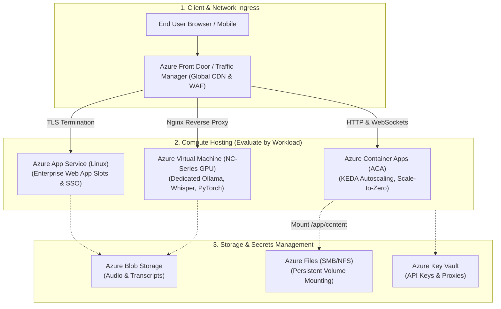
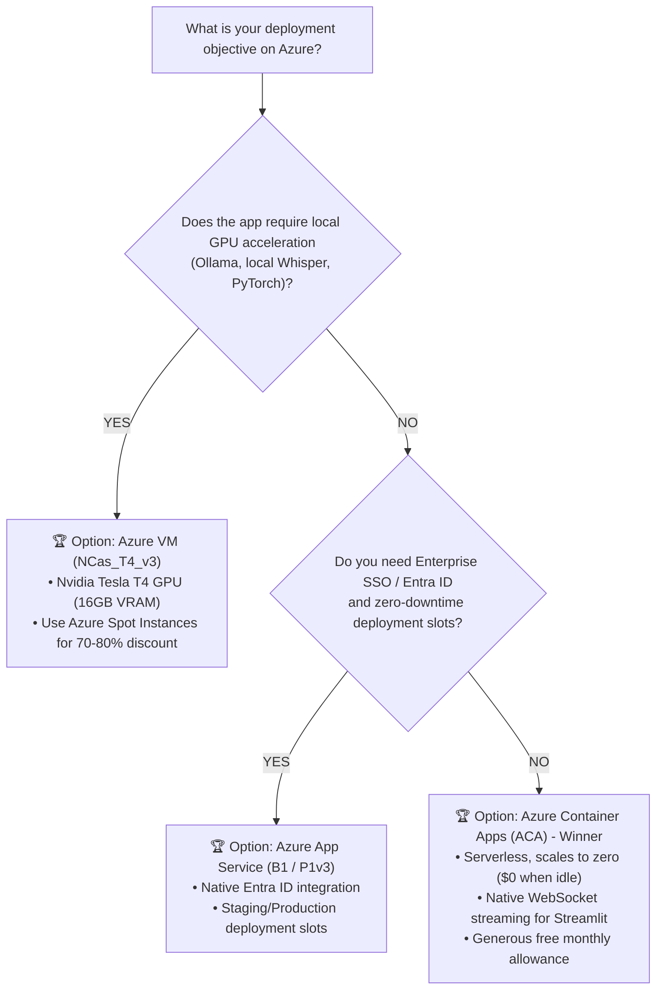

# 🔷 Azure Cloud Deployment: Deep Analysis, Architecture & Decision Guide

This document provides a deep technical analysis of deployment strategies on **Microsoft Azure** for Python, Streamlit, FastAPI, and AI applications (such as *YouTranscribe*, *JARVIS*, *Ollama*, and *Reader*). It evaluates architectural patterns, operational complexity, WebSocket handling, cost structures, and provides prescriptive recommendations based on specific operating conditions.

---

## 📑 Table of Contents
1. [Architectural Overview](#1-architectural-overview)
2. [Deep Dive: The 5 Azure Deployment Pathways](#2-deep-dive-the-5-azure-deployment-pathways)
   - [Pathway A: Azure Container Apps (Serverless K8s & KEDA)](#pathway-a-azure-container-apps-serverless-containers--keda)
   - [Pathway B: Azure App Service (Linux Web App for Containers)](#pathway-b-azure-app-service-managed-paas)
   - [Pathway C: Azure Virtual Machines (CPU & GPU Compute)](#pathway-c-azure-virtual-machines-iaas---cpu--gpu)
   - [Pathway D: Azure Container Instances (ACI - Lightweight Tasks)](#pathway-d-azure-container-instances-aci)
   - [Pathway E: Azure Functions (Event-Driven Serverless)](#pathway-e-azure-functions)
3. [Deep Comparison Matrix](#3-deep-comparison-matrix)
4. [Conditional Recommendation Engine: What to Choose When](#4-conditional-recommendation-engine-which-option-to-choose-under-what-conditions)
5. [Special Technical Considerations for AI & Streamlit](#5-special-technical-considerations-for-ai--streamlit-workloads)
6. [Step-by-Step Production Implementation Guides](#6-step-by-step-production-implementation-guides)
7. [FinOps & Cost Optimization Guide](#7-finops--cost-optimization-guide)

---

## 1. Architectural Overview



---

## 2. Deep Dive: The 5 Azure Deployment Pathways

### Pathway A: Azure Container Apps (Serverless Containers & KEDA)
Azure Container Apps (ACA) is built on top of **Azure Kubernetes Service (AKS)**, **Envoy proxy**, and **KEDA** (Kubernetes Event-driven Autoscaling), abstracted into a fully serverless developer experience.

* **How It Works**: You supply a container image. ACA automatically configures the Envoy ingress proxy, provisions underlying Kubernetes pods, manages TLS, and scales pods based on HTTP traffic or queue depth.
* **WebSocket Support**: ✅ **Supported natively**. Envoy supports bidirectional WebSocket streaming required by Streamlit. You can enable **session affinity** so users stay connected to the same container replica.
* **Autoscaling & Scale-to-Zero**: Supports scaling from **0 to N replicas**. When no traffic arrives, replicas scale down to 0, completely stopping compute billing.
* **Pros**:
  * Microservices-ready with built-in **Dapr** (Distributed Application Runtime) and service-to-service discovery.
  * Very generous **monthly free grant** (first 180,000 vCPU-seconds and 360,000 GiB-seconds free every month).
  * Direct volume mounting via **Azure Files**, allowing multiple container replicas to read and write to the same `content/` folder.
* **Cons**:
  * Cold start latency when scaling up from zero (takes ~15 to 30 seconds for Streamlit to initialize).
  * GPU support on ACA is in preview/specialized regions and significantly more expensive than running a dedicated VM.

---

### Pathway B: Azure App Service (Managed PaaS)
Azure App Service is Microsoft's flagship enterprise Platform-as-a-Service for web applications and APIs, running on dedicated or shared App Service Plans.

* **How It Works**: Runs your application either directly as Python code or as a Docker container (Web App for Containers) behind a fully managed Azure frontend load balancer.
* **WebSocket Support**: ✅ **Supported**, but must be explicitly enabled via `az webapp config set --web-sockets-enabled true`.
* **Enterprise Features**: Seamless integration with **Microsoft Entra ID (formerly Azure AD)** for enterprise Single Sign-On (SSO), deployment slots (staging vs production with zero-downtime slot swapping), and automatic backup.
* **Pros**:
  * Built-in custom domain management with free, auto-renewing Azure managed certificates.
  * Direct integration with Azure DevOps and GitHub Actions deployment centers.
  * Staging deployment slots allow live testing before swapping to production.
* **Cons**:
  * **Always-on pricing**: Unlike ACA, you pay for the App Service Plan 24/7 regardless of traffic. The minimum recommended tier for Docker containers (B1) costs ~$13/month.
  * Slower deployment cycle compared to ACA when pulling large images.

---

### Pathway C: Azure Virtual Machines (IaaS - CPU & GPU)
Direct Infrastructure-as-a-Service (IaaS) virtual machines running Linux (Ubuntu 22.04 LTS), offering complete control over the kernel, drivers, and runtime.

* **GPU Options**:
  * **NCas_T4_v3 Series**: Powered by **Nvidia Tesla T4 GPUs (16GB VRAM)**—ideal for offline AI models (**Ollama, faster-whisper, PyTorch, Stable Diffusion**).
  * **NCv3 Series**: Powered by Nvidia Tesla V100 GPUs for heavy model fine-tuning.
* **Pros**:
  * **Unrestricted compute**: No container timeout limits, no sandbox restrictions, and complete access to local NVMe SSD storage.
  * **Spot Instances**: Azure Spot VMs provide up to **80% to 90% discounts** compared to Pay-As-You-Go pricing.
* **Cons**:
  * High operational overhead: You are responsible for OS security patches, firewall configuration, Nginx setup, and certbot SSL renewal.
  * No automatic scaling out-of-the-box (requires Virtual Machine Scale Sets).

---

### Pathway D: Azure Container Instances (ACI)
A fast, lightweight serverless container execution service designed for single isolated container runs without an orchestration layer.

* **Evaluation**: ACI is fantastic for batch jobs (e.g., automated data migration or offline batch transcription), but **not optimal as a public web application server**.
* **Drawbacks for Streamlit**: ACI does not include a managed ingress load balancer, SSL certificates must be manually orchestrated via sidecar containers, and it does not scale to zero.

---

### Pathway E: Azure Functions
Microsoft's serverless FaaS (Function-as-a-Service) platform.

* **Evaluation**: ❌ **Not Recommended for Streamlit**. While Azure Functions supports ASGI/FastAPI through HTTP triggers, Streamlit's stateful WebSocket architecture breaks across function invocations.
* **Evaluation for REST APIs**: ✅ **Good for standalone micro-APIs** (e.g. `POST /api/transcribe` as an isolated microservice).

---

## 3. Deep Comparison Matrix

| Evaluation Dimension | 🚀 Azure Container Apps (ACA) | 🏢 Azure App Service (Linux) | 💻 Azure VM (B2s CPU) | 🎮 Azure VM (NC6s_T4 GPU) | 📦 Azure Container Instances |
| :--- | :--- | :--- | :--- | :--- | :--- |
| **Ease of Deployment** | **9 / 10** | 7.5 / 10 | 6 / 10 | 5 / 10 | 8 / 10 |
| **DevOps Maintenance** | **None (Serverless)** | Low (Managed PaaS) | High (OS Patching) | High (Nvidia CUDA/Drivers) | Low (Single Task) |
| **WebSocket Compatibility** | Native (Envoy) | Native (Toggle required) | Full Control (Nginx) | Full Control (Nginx) | Raw Port only |
| **Scale-to-Zero** | **Yes (0 Replicas)** | No (Plan always on) | No (Always on) | No (Always on) | No |
| **Persistent Volume Support** | ✅ Azure Files (SMB) | ✅ Azure Storage mount | ✅ Local VHD / Managed Disk | ✅ Local VHD / Managed Disk | ✅ Azure Files |
| **GPU Acceleration** | ❌ Preview / Specialized | ❌ No | ❌ No | ✅ **Yes (Nvidia T4 16GB)** | Optional (expensive) |
| **Free Tier Allowance** | **180,000 vCPU-sec/mo** | F1 Tier (very limited) | None | None | None |
| **Base Monthly Cost (Idle)** | **\$0.00 – \$2.00/mo** | ~\$13.00/mo (B1 Plan) | ~\$15.00/mo | ~\$350/mo (Spot: ~$85/mo) | Per second when active |
| **Deployment Slots** | Revisions (Traffic split) | Deployment Slots (Swap) | Manual (Blue/Green) | Manual (Blue/Green) | None |

---

## 4. Conditional Recommendation Engine: Which Option to Choose Under What Conditions?



---

### Condition 1: Streamlit / FastAPI Web App (Overall Best Option)
* **Recommended Service**: **Azure Container Apps (ACA)**
* **Why**:
  1. ACA handles Streamlit's WebSocket connection pooling natively through Envoy.
  2. With `--min-replicas 0`, your application costs **\$0/month** when not actively receiving traffic.
  3. Includes automated ingress SSL certificates and direct container builds from source via `az acr build`.

---

### Condition 2: Enterprise Applications Requiring Microsoft Entra ID (Azure AD)
* **Recommended Service**: **Azure App Service (Linux Web App)**
* **Why**:
  1. Built-in **Authentication / Authorization (Easy Auth)**: Protect your application with corporate Microsoft 365 / Entra ID login without writing a single line of auth code.
  2. **Deployment Slots**: Deploy updates to a `staging` slot, verify functionality, and perform a zero-downtime swap into `production`.

---

### Condition 3: Offline AI Models & Heavy GPU Workloads (Ollama, Whisper)
* **Recommended Service**: **Azure Virtual Machine `Standard_NC4as_T4_v3`**
* **Why**:
  1. Provides **1 Nvidia Tesla T4 GPU (16GB VRAM)**, 4 AMD EPYC vCPUs, and 28GB RAM.
  2. Can run **Ollama** continuously in the background alongside your web app.
  3. **FinOps Tip**: Deploy as an **Azure Spot VM** to reduce the hourly rate from ~$0.526/hour to **~$0.12/hour** (~$85/month).

---

## 5. Special Technical Considerations for AI & Streamlit Workloads

### 1. Enabling WebSockets in Azure
* **In Azure Container Apps**: WebSockets are enabled by default through Envoy. To ensure users remain connected to the same replica during long sessions, configure session affinity:
  ```bash
  az containerapp ingress sticky-sessions set \
    --name youtranscribe-app \
    --resource-group rg-transcribe \
    --affinity sticky
  ```
* **In Azure App Service**: WebSockets are disabled by default. You must run:
  ```bash
  az webapp config set --resource-group rg-transcribe --name youtranscribe-app --web-sockets-enabled true
  ```

### 2. Shared Persistent Storage with Azure Files
Serverless containers lose local disk state on restart. To persist transcripts saved in `content/`:
1. Create an Azure Storage Account and file share.
2. Mount the file share directly into the Container App at `/app/content`.
3. All container replicas and revisions share the exact same transcript history seamlessly.

### 3. Overcoming YouTube Cloud IP Blocks
YouTube frequently blocks requests originating from Azure datacenter IP ranges.
* **Solution**: Add an **Azure NAT Gateway** with a dedicated Public IP to your Container App's virtual network, or route outgoing requests via an egress proxy (`HTTPS_PROXY`).

---

## 6. Step-by-Step Production Implementation Guides

### Pathway 1: Production Deployment to Azure Container Apps (with Storage)

#### Step 1: Resource Group, ACR & Storage Setup

```bash
# Variables
RG="rg-transcribe-prod"
LOCATION="eastus"
ACR="acrtranscribe$RANDOM"
STORAGE_ACCOUNT="satranscribe$RANDOM"
SHARE_NAME="transcript-content"

# 1. Create Resource Group & Registry
az group create --name $RG --location $LOCATION
az acr create --resource-group $RG --name $ACR --sku Basic --admin-enabled true

# 2. Build image in the cloud (no local Docker required)
az acr build --registry $ACR --image youtranscribe:latest .

# 3. Create Storage Account for persistent content logs
az storage account create --resource-group $RG --name $STORAGE_ACCOUNT --location $LOCATION --sku Standard_LRS
STORAGE_KEY=$(az storage account keys list --resource-group $RG --account-name $STORAGE_ACCOUNT --query "[0].value" -o tsv)
az storage share create --account-name $STORAGE_ACCOUNT --account-key $STORAGE_KEY --name $SHARE_NAME
```

#### Step 2: Container Apps Environment & Persistent Mount

```bash
# 1. Create ACA Environment
az containerapp env create --name transcribe-env --resource-group $RG --location $LOCATION

# 2. Link Azure Files to ACA Environment
az containerapp env storage set \
  --name transcribe-env \
  --resource-group $RG \
  --storage-name transcriptStorage \
  --azure-file-account-name $STORAGE_ACCOUNT \
  --azure-file-account-key $STORAGE_KEY \
  --azure-file-share-name $SHARE_NAME \
  --access-mode ReadWrite
```

#### Step 3: Deploy the Container App with Volume Mount

```bash
ACR_PASS=$(az acr credential show --name $ACR --query "passwords[0].value" -o tsv)

az containerapp create \
  --name youtranscribe-app \
  --resource-group $RG \
  --environment transcribe-env \
  --image "$ACR.azurecr.io/youtranscribe:latest" \
  --target-port 8501 \
  --ingress external \
  --registry-server "$ACR.azurecr.io" \
  --registry-username $ACR \
  --registry-password $ACR_PASS \
  --cpu 1.0 \
  --memory 2.0Gi \
  --min-replicas 0 \
  --max-replicas 5 \
  --scale-rule-name http-rule \
  --scale-rule-http-concurrency 50
```

---

## 7. FinOps & Cost Optimization Guide

1. **Leverage the ACA Free Monthly Grant**:
   * The first **180,000 vCPU-seconds** and **360,000 GiB-seconds** per month are **100% free**. For side projects and personal tools, your monthly invoice will often be **\$0.00**.
2. **Set Minimum Replicas to 0**:
   * Always configure `--min-replicas 0` in non-critical production environments to eliminate idle costs during off-peak hours.
3. **Use Azure Cost Management Budgets**:
   * Set up an Azure Budget in the portal with an automated email trigger when spending exceeds **\$10.00**.
4. **Clean Stale ACR Images**:
   * Set up an ACR retention policy or run periodic cleanup tasks to prevent untagged container manifests from accumulating storage charges.
