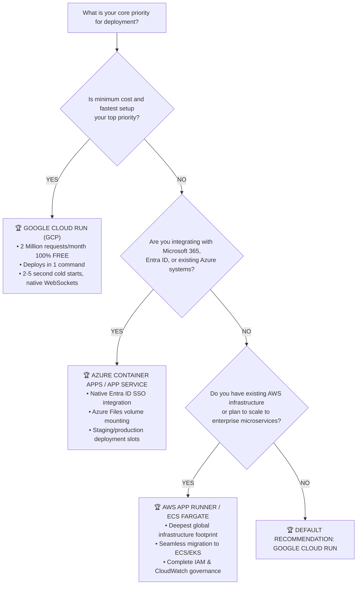

# 📊 Tri-Cloud Deployment Comparison & Final Conclusion

This document synthesizes the in-depth technical analyses conducted across **Amazon Web Services (AWS)**, **Microsoft Azure**, and **Google Cloud Platform (GCP)** for deploying Python, Streamlit, FastAPI, and AI applications.

For exhaustive, platform-specific guides, refer to:
* ☁️ **[AWS Deployment Deep Analysis](file:///d:/AI/deployment/AWS_Deployment.md)**
* 🔷 **[Azure Deployment Deep Analysis](file:///d:/AI/deployment/Azure_Deployment.md)**
* 🇬 **[GCP Deployment Deep Analysis](file:///d:/AI/deployment/GCP_Deployment.md)**

---

## ⚖️ Comprehensive Tri-Cloud Matrix

| Evaluation Dimension | ☁️ AWS (App Runner) | 🔷 Azure (Container Apps) | 🇬 GCP (Cloud Run) |
| :--- | :--- | :--- | :--- |
| **Category Winner** | Best for Enterprise Scaling | Best for Microsoft Ecosystem | 🏆 **Best Overall & Lowest Cost** |
| **Deployment Speed** | 2 – 4 minutes | 2 – 4 minutes | **< 2 minutes (`gcloud run deploy`)** |
| **Concurrency Model** | Managed instances | Pod replicas (KEDA) | **Up to 1,000 reqs/container instance** |
| **Scale-to-Zero Capability** | Partial (vCPU pauses, memory billed) | Yes (Scales to 0 replicas) | **Yes (100% idle stop, zero cost)** |
| **Cold Start Duration** | 10 – 20 seconds | 15 – 30 seconds | **2 – 5 seconds** |
| **Native WebSocket Support** | Yes (Built-in) | Yes (Envoy Ingress) | **Yes (Up to 60 min timeouts)** |
| **Monthly Free Tier** | Free trial credits only | 180k vCPU-s, 360k GiB-s | **2,000,000 Requests / Month FREE** |
| **Persistent Volume Support** | Amazon EFS (ECS only) | Azure Files (SMB mount) | **Google Cloud Storage (GCS FUSE)** |
| **GPU Compute Access** | EC2 `g4dn` (T4) / `g5` (A10G) | NCas_T4_v3 (T4 GPU) | **Compute Engine `g2` (Nvidia L4 24GB)** |
| **Typical Monthly Idle Cost** | ~\$5.00 – \$15.00 / month | ~\$0.00 – \$8.00 / month | **\$0.00 / month** |

---

## 🎯 The Final Verdict: Which Cloud Under Which Condition?

---

## 📌 Summary of Recommendations

1. **For 90% of Projects & Fast MVPs**: Choose **Google Cloud Run (GCP)**. It is hands-down the fastest, most cost-effective, and easiest container hosting service available today.
2. **For Corporate & Enterprise Teams**: Choose **Azure Container Apps** or **App Service** if your organization utilizes Microsoft 365, GitHub Enterprise, or Microsoft Entra ID.
3. **For Large-Scale Production Systems**: Choose **AWS App Runner** (or **ECS Fargate**) if your application connects to AWS DynamoDB, RDS, S3, or if your engineering team already specializes in AWS.
4. **For Offline AI & Local LLMs (Ollama, Whisper)**: Do not use serverless containers. Use **Dedicated GPU Virtual Machines** with Spot pricing:
   * **GCP Compute Engine with Nvidia L4 (24GB VRAM)**
   * **AWS EC2 `g4dn.xlarge` with Nvidia T4 (16GB VRAM)**
