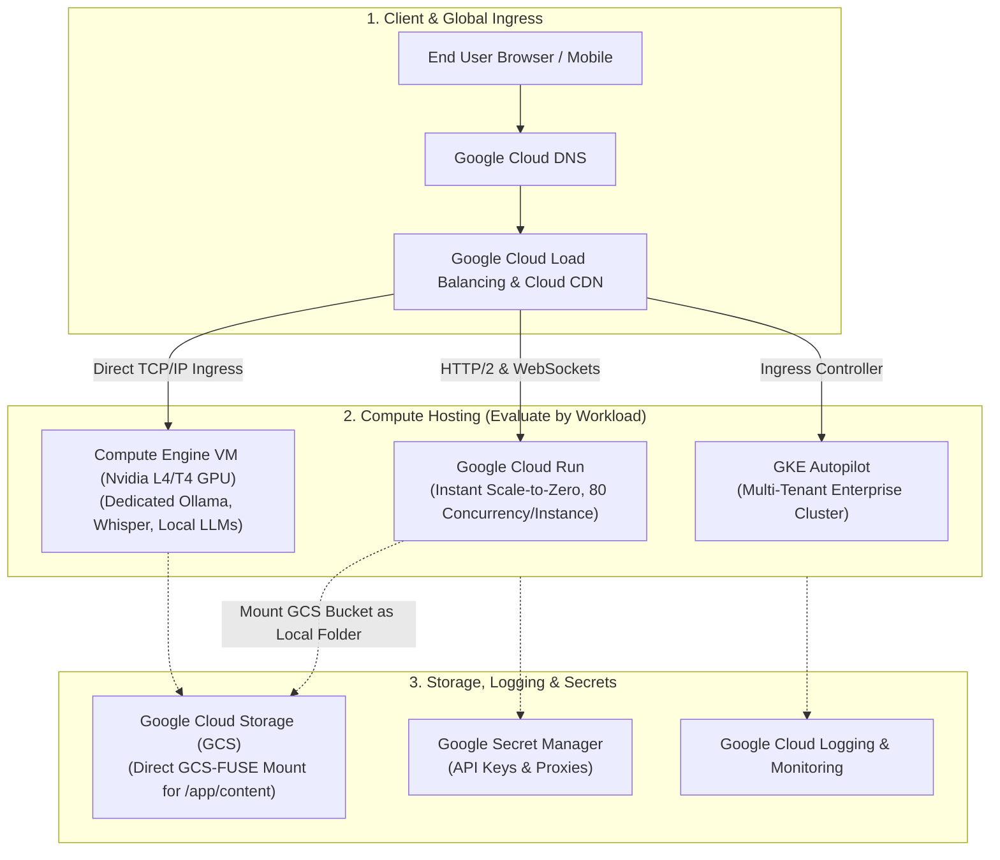
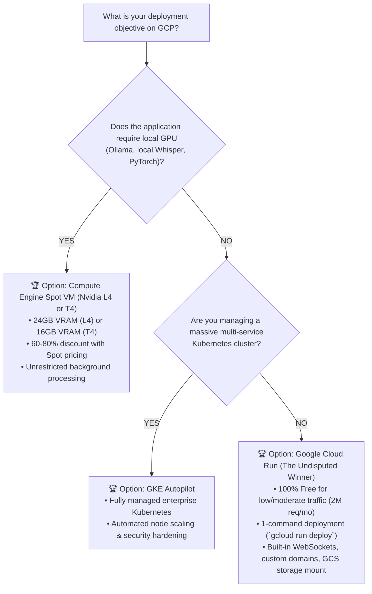

# 🇬 Google Cloud (GCP) Deployment: Deep Analysis, Architecture & Decision Guide

This document provides a deep technical analysis of deployment strategies on **Google Cloud Platform (GCP)** for Python, Streamlit, FastAPI, and AI applications (such as *YouTranscribe*, *JARVIS*, *Ollama*, and *Reader*). It evaluates architectural patterns, operational complexity, WebSocket handling, cost structures, and provides prescriptive recommendations based on specific operating conditions.

---

## 📑 Table of Contents
1. [Architectural Overview](#1-architectural-overview)
2. [Deep Dive: The 5 GCP Deployment Pathways](#2-deep-dive-the-5-gcp-deployment-pathways)
   - [Pathway A: Google Cloud Run (Serverless Managed Containers - Top Recommendation)](#pathway-a-google-cloud-run-serverless-managed-containers)
   - [Pathway B: Google Compute Engine (CPU & GPU Virtual Machines)](#pathway-b-google-compute-engine-iaas---cpu--gpu)
   - [Pathway C: Google Kubernetes Engine (GKE Autopilot)](#pathway-c-google-kubernetes-engine-gke-autopilot)
   - [Pathway D: Google App Engine (Flexible Environment)](#pathway-d-google-app-engine)
   - [Pathway E: Cloud Run Functions (Event-Driven Serverless)](#pathway-e-cloud-run-functions)
3. [Deep Comparison Matrix](#3-deep-comparison-matrix)
4. [Conditional Recommendation Engine: What to Choose When](#4-conditional-recommendation-engine-which-option-to-choose-under-what-conditions)
5. [Special Technical Considerations for AI & Streamlit](#5-special-technical-considerations-for-ai--streamlit-workloads)
6. [Step-by-Step Production Implementation Guides](#6-step-by-step-production-implementation-guides)
7. [FinOps & Cost Optimization Guide](#7-finops--cost-optimization-guide)

---

## 1. Architectural Overview



---

## 2. Deep Dive: The 5 GCP Deployment Pathways

### Pathway A: Google Cloud Run (Serverless Managed Containers)
Google Cloud Run is widely regarded across the cloud industry as the **single best platform for deploying containerized Python and Streamlit web applications**. It combines serverless scale-to-zero with the ability to handle high concurrency inside a single container instance.

* **How It Works**: Built on the open-source **Knative** standard and secured with **gVisor** sandboxing. You supply any container image; Cloud Run provisions the infrastructure, attaches a global Anycast HTTPS load balancer, handles TLS certificates, and scales instances up or down based on concurrent traffic.
* **Concurrency Model (Huge Advantage over AWS Lambda)**:
  * While AWS Lambda processes only 1 request per container instance at a time, Cloud Run allows **up to 1,000 concurrent requests per single container instance** (default: 80).
  * This is ideal for Streamlit: multiple users can connect to the same container instance over persistent WebSockets without spinning up new containers for every tab.
* **WebSocket Support**: ✅ **Native & First-Class**. WebSockets are supported out-of-the-box with no special ingress configuration. Cloud Run supports request timeouts up to **60 minutes** (3,600 seconds).
* **Storage Persistence (GCS FUSE)**: Cloud Run allows you to mount a **Google Cloud Storage (GCS) bucket as a local file system directory** (e.g. `/app/content`) with zero custom code!
* **Pros**:
  * **Most generous free tier in the cloud**: 2 million requests, 360,000 vCPU-seconds, and 180,000 GiB-seconds free every single month.
  * Rapid cold starts (typically 2 to 5 seconds).
  * Instant deployment with a single CLI command (`gcloud run deploy`).
* **Cons**:
  * GPU support on Cloud Run is currently in private preview and limited to specific regions. For heavy local AI models, Compute Engine is better suited.

---

### Pathway B: Google Compute Engine (IaaS - CPU & GPU)
Direct virtual machines running on Google's world-class global fiber network.

* **GPU Options for Local AI**:
  * **`g2-standard-4`**: Powered by the modern **Nvidia L4 GPU (24GB VRAM)**. Excellent for high-speed inference on **Ollama (Llama 3 8B/70B quantized), faster-whisper, and Stable Diffusion**.
  * **`n1-standard-4` with Nvidia T4**: Cost-effective option providing 16GB VRAM.
* **Spot VMs (Preemptible)**: Google Cloud offers up to **60% to 91% discounts** on Compute Engine VMs (including GPUs) if you use Spot VMs.
* **Pros**:
  * Deep Learning VM images pre-configured with Nvidia CUDA, cuDNN, PyTorch, and Docker.
  * Direct access to local high-speed NVMe SSD scratch disks.
  * Static External IP addresses available with no additional hourly charge while the VM is running.
* **Cons**:
  * Self-managed: Requires manual OS maintenance, Nginx configuration, and Let's Encrypt SSL management.

---

### Pathway C: Google Kubernetes Engine (GKE Autopilot)
GKE Autopilot is Google's fully managed Kubernetes service where Google manages the control plane, node provisioning, and security hardening.

* **Evaluation**: GKE is the industry leader for Kubernetes, but **overkill for a single Streamlit web application**.
* **When to Use**: Choose GKE only if you are building an entire enterprise microservice suite (e.g., frontend, auth service, vector database, Celery workers, and GPU inference pods) requiring shared Kubernetes networking and Multi-Instance GPU (MIG) slicing.

---

### Pathway D: Google App Engine
Google's legacy Platform-as-a-Service (PaaS).

* **Evaluation**: ⚠️ **Superseded by Cloud Run**. App Engine Flexible supports Docker containers, but deployments are slow (5–10 minutes), instance pricing is higher, and it lacks the advanced networking and pricing advantages of Cloud Run.

---

### Pathway E: Cloud Run Functions (formerly Cloud Functions 2nd Gen)
Event-driven serverless execution built on top of Cloud Run infrastructure.

* **Evaluation**: ❌ **Not Recommended for Streamlit**. While great for stateless webhook handlers, Streamlit's stateful WebSocket engine is not designed for ephemeral function invocations.

---

## 3. Deep Comparison Matrix

| Evaluation Dimension | 🚀 Google Cloud Run | 💻 Compute Engine (e2-medium) | 🎮 Compute Engine GPU (g2/n1) | ☸️ GKE Autopilot | 📦 App Engine Flex |
| :--- | :--- | :--- | :--- | :--- | :--- |
| **Ease of Deployment** | **10 / 10 (Fastest in Industry)** | 6 / 10 | 5 / 10 | 4 / 10 | 7 / 10 |
| **DevOps Maintenance** | **Zero (Fully Serverless)** | High (Manual updates) | High (Nvidia drivers) | Low (Automated K8s) | Low (PaaS) |
| **WebSocket Compatibility** | **Native (Up to 60 mins)** | Full Control (Nginx) | Full Control (Nginx) | Ingress Controller | Native |
| **Scale-to-Zero** | **Yes (Instant to 0 instances)** | No (Always on) | No (Always on) | Partial | Yes (Standard only) |
| **Persistent Volume Support** | ✅ **GCS FUSE Mount** | ✅ Persistent Disks (SSD) | ✅ Persistent Disks (SSD) | ✅ GKE Storage Classes | ❌ Ephemeral |
| **GPU Acceleration** | ❌ Preview only | ❌ CPU only | ✅ **Yes (Nvidia L4 / T4)** | ✅ Yes (GPU Node Pools) | ❌ No |
| **Free Tier Allowance** | **2,000,000 req/mo FREE** | `e2-micro` (US regions) | None | \$300 credits only | Limited |
| **Base Monthly Cost (Idle)** | **\$0.00 / month** | ~\$25.00 / month | ~\$280/mo (Spot: ~$85/mo) | ~\$74.00/mo (Cluster fee) | ~\$35.00 / month |
| **Cold Start Duration** | **2 – 5 seconds** | Instant (Always running) | Instant (Always running) | 30 – 60 seconds | 30 – 90 seconds |

---

## 4. Conditional Recommendation Engine: Which Option to Choose Under What Conditions?



---

### Condition 1: Streamlit / FastAPI Web App (The Undisputed Winner)
* **Recommended Service**: **Google Cloud Run**
* **Why**:
  1. **Virtually Free**: The 2 million free monthly requests mean personal tools, MVPs, and internal dashboards typically cost **\$0.00/month**.
  2. **Superior Concurrency**: A single container instance handles dozens of simultaneous Streamlit WebSocket connections.
  3. **Fastest Time to Production**: `gcloud run deploy` packages, builds, provisions HTTPS, and deploys in under 2 minutes.

---

### Condition 2: Offline AI Models & Heavy GPU Workloads (Ollama, Whisper)
* **Recommended Service**: **Compute Engine `g2-standard-4` (Nvidia L4 GPU)**
* **Why**:
  1. The **Nvidia L4 GPU (24GB VRAM)** is Google's flagship modern AI inference accelerator (Ada Lovelace architecture). It runs **Llama 3 8B, Mistral 7B, and Whisper Large-v3** at ultra-fast tokens per second.
  2. **FinOps Tip**: Use **Spot VMs** (`--provisioning-model=SPOT`) to reduce monthly GPU hosting costs from ~$280/mo down to **~$85/mo**.

---

### Condition 3: YouTube Transcription & Avoiding Datacenter IP Blocks
* **Recommended Service**: **Cloud Run paired with Cloud NAT** (or Egress Proxy)
* **Why**:
  1. Like all major clouds, YouTube occasionally blocks shared datacenter IPs.
  2. With Cloud Run, you can route outbound egress traffic through a **Serverless VPC Access Connector** attached to a **Cloud NAT Gateway with a dedicated static IP address**.
  3. Alternatively, configuring `HTTPS_PROXY` in Cloud Run environment variables routes YouTube requests through residential proxy pools seamlessly.

---

## 5. Special Technical Considerations for AI & Streamlit Workloads

### 1. Concurrency & Session Affinity
By default, Cloud Run load balances new HTTP connections across container instances. For stateful Streamlit sessions:
```bash
gcloud run services update youtranscribe \
  --session-affinity \
  --timeout=3600 \
  --concurrency=80
```
* `--session-affinity`: Routes all requests from a specific user session to the same container instance.
* `--timeout=3600`: Prevents WebSockets from disconnecting during hour-long video transcriptions.
* `--concurrency=80`: Allows up to 80 simultaneous user connections per container instance before scaling up a second instance.

### 2. Zero-Code Persistent Volume Mounting via GCS FUSE
In Cloud Run (2nd generation execution environment), you can mount an entire Google Cloud Storage bucket directly into your container:
```bash
gcloud run deploy youtranscribe \
  --add-volume=name=transcript-store,type=cloud-storage,bucket=YOUR_GCS_BUCKET_NAME \
  --add-volume-mount=volume=transcript-store,mount-path=/app/content
```
Every time the app logs a transcript to `content/<title>.txt`, it is automatically and persistently saved into your Google Cloud Storage bucket!

---

## 6. Step-by-Step Production Implementation Guides

### Pathway 1: Production Deployment to Google Cloud Run

#### Step 1: Initialize GCP & Artifact Registry

```bash
# Set environment variables
export PROJECT_ID="your-gcp-project-id"
export REGION="us-central1"
export REPO_NAME="transcribe-repo"
export SERVICE_NAME="youtranscribe"

# 1. Authenticate and select project
gcloud auth login
gcloud config set project $PROJECT_ID

# 2. Enable APIs
gcloud services enable \
    run.googleapis.com \
    artifactregistry.googleapis.com \
    cloudbuild.googleapis.com \
    storage.googleapis.com

# 3. Create Artifact Registry Docker Repository
gcloud artifacts repositories create $REPO_NAME \
    --repository-format=docker \
    --location=$REGION \
    --description="Docker repository for YouTranscribe"

# 4. Create Cloud Storage Bucket for persistent transcript logs
gsutil mb -l $REGION gs://${PROJECT_ID}-transcripts
```

#### Step 2: Build & Deploy Container in 1 Command

```bash
# 1. Build container image using Cloud Build
gcloud builds submit --tag ${REGION}-docker.pkg.dev/${PROJECT_ID}/${REPO_NAME}/${SERVICE_NAME}:latest

# 2. Deploy to Cloud Run with GCS Volume Mount, Session Affinity, and 3600s Timeout
gcloud run deploy $SERVICE_NAME \
    --image ${REGION}-docker.pkg.dev/${PROJECT_ID}/${REPO_NAME}/${SERVICE_NAME}:latest \
    --platform managed \
    --region $REGION \
    --allow-unauthenticated \
    --port 8501 \
    --cpu 1 \
    --memory 2Gi \
    --concurrency 80 \
    --timeout 3600 \
    --session-affinity \
    --min-instances 0 \
    --max-instances 5 \
    --execution-environment gen2 \
    --add-volume name=content-vol,type=cloud-storage,bucket=${PROJECT_ID}-transcripts \
    --add-volume-mount volume=content-vol,mount-path=/app/content
```

---

### Pathway 2: Automated CI/CD with GitHub Actions (Keyless Workload Identity)

Create `.github/workflows/deploy-gcp.yml`:

```yaml
name: Deploy to Google Cloud Run

on:
  push:
    branches: [ main ]

jobs:
  build-and-deploy:
    runs-on: ubuntu-latest
    steps:
      - name: Checkout Repository
        uses: actions/checkout@v3

      - name: Authenticate to Google Cloud
        uses: google-github-actions/auth@v1
        with:
          credentials_json: ${{ secrets.GCP_SA_KEY }}

      - name: Set up Cloud SDK
        uses: google-github-actions/setup-gcloud@v1

      - name: Configure Docker Authentication
        run: gcloud auth configure-docker us-central1-docker.pkg.dev

      - name: Build & Push Docker Image
        run: |
          IMAGE_URI="us-central1-docker.pkg.dev/${{ secrets.GCP_PROJECT_ID }}/transcribe-repo/youtranscribe:latest"
          docker build -t $IMAGE_URI .
          docker push $IMAGE_URI

      - name: Deploy to Cloud Run
        run: |
          gcloud run deploy youtranscribe \
            --image us-central1-docker.pkg.dev/${{ secrets.GCP_PROJECT_ID }}/transcribe-repo/youtranscribe:latest \
            --region us-central1 \
            --platform managed \
            --allow-unauthenticated \
            --port 8501 \
            --session-affinity \
            --timeout 3600
```

---

## 7. FinOps & Cost Optimization Guide

1. **Keep `--min-instances 0`**:
   * Unless your application requires sub-second cold starts, keep min instances at 0. Cold starts on Cloud Run take only **2–4 seconds** for Streamlit, saving you 100% of idle costs.
2. **CPU Allocation Model**:
   * By default, Cloud Run uses **request-based CPU allocation** (`--no-cpu-throttling=false`), meaning you are only billed for CPU time while an active request or WebSocket heartbeat is being processed.
3. **Set Up a Google Cloud Budget Alert**:
   * Navigate to **GCP Console ➔ Billing ➔ Budgets & Alerts**.
   * Create an alert at **\$10.00/month** to notify your email when spend hits 50%, 80%, and 100%.
4. **Use Spot VMs for Compute Engine**:
   * If running offline Ollama or Whisper inference, always create your VM with `--provisioning-model=SPOT` to lock in **60% to 91% cost savings**.
